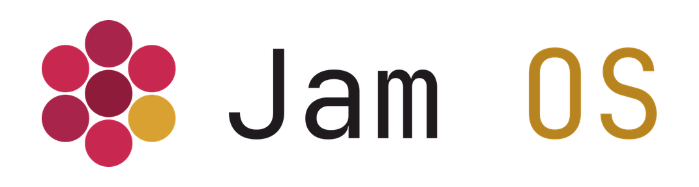
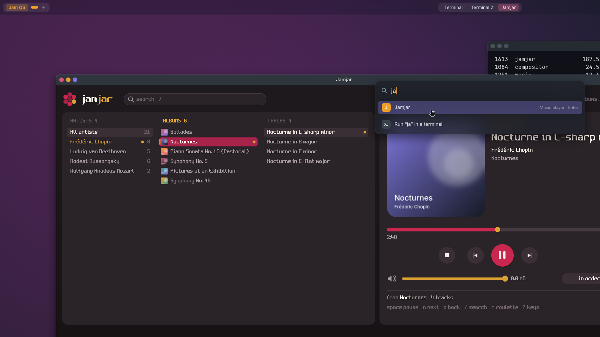

<h1 align="center">
  <picture>
    <source media="(prefers-color-scheme: dark)" srcset="docs/logo/jamos-lockup-dark.png">
    
  </picture>
</h1>

Jam OS is a from-scratch operating system for x86_64 PCs, written in C.
Every driver and service is a separate process that can only use the
handles it is given, so a crashed driver doesn't take the system down. It
boots from a USB stick, or from an NVMe drive it was installed on, on a
real PC into a desktop of its own.

## A tour


The desktop, tiled: each new window splits the one in focus, here two
terminals and Jamjar, the music player, playing from a USB stick.



The search box: tap Super (or click "Jam OS" on the top bar) to start an
app or run a command in a new terminal.


The same windows floating (Super+T switches a screen): the jam circles
on each title bar close, minimise and go full screen.

## What works today

Jam OS boots on all 28 CPUs of its author's PC into a tiling Wayland
desktop of its own, with terminals, a shell, a music player and a search
box. Its drivers (USB, Intel HD Audio, the Realtek RTL8125B network chip,
NVMe) and its services are separate processes that are started again when
they crash, the drivers kept inside the IOMMU. It has FAT32 sticks and a
filesystem of its own in ext4's on-disk format (journalled, with links
and permissions); it installs itself onto an NVMe drive without touching
the Windows drive beside it, and updates itself over the network from
signed builds; a package system (`pkg`) installs signed packages from a
repository on the Mac. A POSIX layer on musl runs ported software (sbase,
Lua, and an SSH server you log into with a key) and carries Chromium:
`content_shell` runs on the desktop as a multi-process browser with V8's
JIT, system fonts for most scripts and sound, and with WebGL in software
when asked for; `chrome`, the full browser, is being finished. Chromium
has no sandbox of Jam OS's own yet, so it is for ordinary sites only, and
so far it has run in QEMU and, in its headless form, on the PC. There is no
GPU acceleration, Wi-Fi, power management or sleep yet, no Linux binaries
run, and the system call interface is not frozen.

## Try it

On macOS, with [Homebrew](https://brew.sh):

```sh
brew install x86_64-elf-gcc qemu mtools
make run
```

On a real PC: `make usb DEV=/dev/diskN` writes a stick (it erases the
whole disk), then boot it in UEFI mode with Secure Boot off. More in
[docs/HARDWARE.md](docs/HARDWARE.md).

To build and test: `make` builds the kernel, the programs and the boot
image, and `make check` runs the checks that need no machine (generated
code current, the drivers' isolation, the docs, the ports and the package
formats). The tests run Jam OS in QEMU: `tools/qemu-test.sh` runs one,
`tools/init-test.sh` the user-space regression run, `ktest` the kernel's
own tests at 4 and 8 CPUs, with shell, area and soak scripts beside them.
The author runs every QEMU test on his PC (`tools/pc-batch.sh` copies the
checkout there, builds once and prints one table). [docs/TESTING.md](docs/TESTING.md)
has the tiers and every script.

## What's next

The goal is to run Chromium, reached layer by layer: each layer a
general piece of the system that later ports use too. What is left on that
path: `chrome` as an installable package, then Jam OS's own sandbox for
its processes, then rendering on the Intel iGPU together with measuring
how well the browser runs against Linux on the same PC; power management,
a stable system call interface and self-hosting come after. The plan:
[docs/ROADMAP.md](docs/ROADMAP.md).

## Documentation

- [docs/USING.md](docs/USING.md): the desktop, its keys, the shell, programs, the browser and updating
- [ARCHITECTURE.md](ARCHITECTURE.md): how it is designed, and why
- [CODING-GUIDE.md](CODING-GUIDE.md): how the code is written, and the build commands
- [docs/TESTING.md](docs/TESTING.md): the tests
- [docs/HARDWARE.md](docs/HARDWARE.md): the PC, and flashing the stick
- [docs/NETWORK.md](docs/NETWORK.md): the network, `ssh` and `update`
- [docs/ROADMAP.md](docs/ROADMAP.md) and [docs/HISTORY.md](docs/HISTORY.md): what's next and what's done

## Licence

[BSD 2-Clause](LICENSE). A separate program (a driver, a service or a
package) may be under the GPL or LGPL, with its source shipped beside it;
the kernel, the libraries and the rest stay BSD ([CONTRIBUTING](CONTRIBUTING.md)).
None is in the tree yet. The code in `third_party/` keeps its own licences
(Limine: BSD-2-Clause; `limine.h`: 0BSD; Spleen: BSD-2-Clause; FatFs: its
own one-clause BSD-style licence; dr_mp3: public domain or MIT-0;
pl_mpeg: MIT; stb_image and stb_truetype: MIT or public domain; Inter and
JetBrains Mono: SIL Open Font License 1.1; Wayland's protocol files: MIT;
lwIP: BSD-3-Clause; Monocypher: BSD-2-Clause, or CC0; tinyssh: public
domain, as CC0-1.0, 0BSD, MIT-0 or MIT; musl, Lua, sbase and libc-test:
MIT). Chromium and the font packages are built from their own sources and
are not in this repository. The music in the
pictures is public-domain recordings from the Internet Archive (Musopen
and others); none of it is in this repository.
